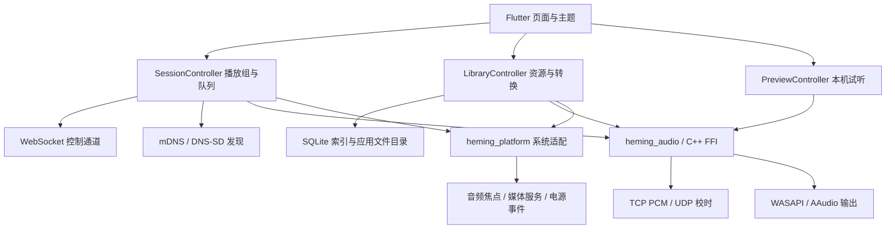
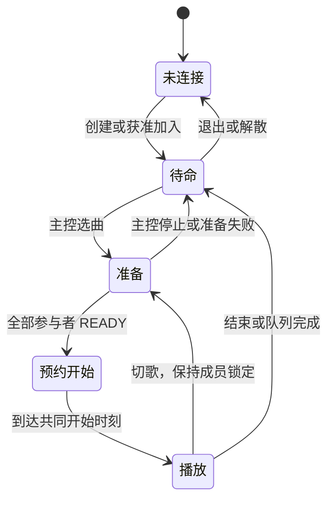

# 架构设计

本文描述和鸣 1.5.0 的当前实现。使用规则见[产品规格](v1-spec.md)，构建步骤见[开发指南](build-and-test.md)，底层细节分别见[局域网协议](protocol.md)和[原生音频](audio-engine.md)。

## 整体结构

Windows 和 Android 共用 Flutter 应用层。Dart 管理资源、播放组和队列，C++ 执行音频解码、网络供数、校时与预约输出；平台插件处理系统生命周期和音频焦点。

音频采样数据不经过 Dart 控制消息。实际出声由原生音频回调和单调时钟调度，Dart 定时器仅用于状态更新、超时和界面显示。

## 模块职责

| 模块 | 职责 | 代码入口 |
| --- | --- | --- |
| 应用壳与界面 | 导航、响应式布局、主题、操作入口 | [`lib/app`](../lib/app)、[`lib/features`](../lib/features) |
| 会话控制 | 成员审批、权限、任务、队列、主控移交、异常停止 | [`SessionController`](../lib/session/session_controller.dart) |
| 资源管理 | 原件导入、规格检测、分组、显式转换、播放前校验 | [`lib/data`](../lib/data) |
| 本机试听 | 未组队时的独立播放、暂停、定位和取消 | [`lib/preview`](../lib/preview) |
| 网络控制 | 有界 JSON 消息、自动发现、手动连接 | [`lib/networking`](../lib/networking) |
| 音频内核 | C ABI、解码、PCM 缓冲、TCP/UDP、音频输出 | [`heming_audio`](../packages/heming_audio/README.md) |
| 系统适配 | Android 服务与焦点、Windows 电源与输出通知、系统媒体提取 | [`heming_platform`](../packages/heming_platform/README.md) |

`SessionController` 是播放组状态的唯一协调者。页面订阅同一份状态，不另建主从权限或播放状态机。`AudioSessionPort` 隔离业务层与原生引擎，也允许控制层测试使用替代实现。

## 技术选择

| 领域 | 当前实现 |
| --- | --- |
| 界面 | Flutter / Dart，手机底部导航、桌面侧栏 |
| 本地数据 | SQLite；原件、播放副本和临时文件分开管理 |
| 原生接入 | Dart FFI / C ABI；构建 hook 编译 C++17，CMake 提供独立构建与测试 |
| 基础媒体处理 | 固定版本 miniaudio 0.11.26，WAV / MP3 / FLAC 解码与重采样 |
| 额外媒体格式 | Windows Media Foundation；Android MediaExtractor / MediaCodec |
| 播放副本 | 自有 FLAC verbatim 编码器，48 kHz / 16-bit / 双声道 |
| 系统输出 | Windows WASAPI；Android AAudio，经 miniaudio 接入 |
| 发现与控制 | IPv4 mDNS / DNS-SD；WebSocket / JSON |
| 音频与校时 | TCP 分块拉取 PCM；UDP 单播四时间戳测量 |

当前运行包不包含 FFmpeg，也未使用 Oboe。FFmpeg 只用于部分开发测试素材和独立校验。第三方组件的版本及许可声明见[第三方说明](../packages/heming_audio/THIRD_PARTY_NOTICES.md)。

## 资源到播放的路径

1. 导入时复制原文件到应用管理目录，建立索引；不改写用户源文件、不自动转码。
2. 检测实际编码和音频规格。已符合要求且通过校验的 FLAC 可直接播放，其他格式需要用户点击“转换”。
3. 转换输出先写入独立临时文件，通过完整解码和规格检查后才提交为可播放副本。失败或取消不会把半成品标成可播放。
4. 主控选择单曲或资源分组，生成本轮队列快照；每次开始曲目前重新检查文件。
5. 主控和从机准备约五秒 PCM，完成校时及 READY 屏障后，按同一未来时刻开始原生输出。

当前网络规格是 48,000 Hz、signed 16-bit、双声道交错 PCM：每个接收端每秒 192,000 字节，五个从机合计约 7.68 Mbps 音频净数据；五秒缓冲约 960,000 字节。该估算不含协议、重传和 Wi-Fi 开销，不等于六台硬件容量验收结果。

资源分组只修改索引元数据，不搬动音频文件。异步检测与转换提交时保留最新分组信息；本轮播放开始后新增或刚转换完成的资源不自动插入当前队列。

## 播放组与任务

播放组最多六台设备，包含一台主控。每次建组或移交生成新的会话 ID；每次准备歌曲生成新的任务 ID。成员集合在准备和播放期间锁定，切歌仍保持锁定，直到本轮结束或明确停止。

切歌、加入、移交和音频焦点操作都可能跨越异步边界。控制器使用会话 ID、任务 ID、队列修订号与本机操作代次丢弃迟到结果，避免旧 READY、旧音频完成事件或旧连接回调覆盖新状态。

主动移交主控会先全组停止并清缓存，再让原成员连接新主控，保留声道、音量和静音设置。新主控不会自动续播旧歌曲。主控音频输出中断且控制连接仍保留时，需用户明确选择继续使用原主控或接受接管；主控网络失联后停止播放并重新建组，两种情况都不会自动选主。

## 同步播放与本机试听

同步播放提供切歌和顺序／随机模式，不提供暂停后续播或拖动进度。默认顺序；模式变化从下一首或点选曲目开始应用，不重启当前歌曲。具体队列历史规则见[协议](protocol.md#队列与切歌)。

未组队时，本机试听使用独立 `NativePreviewPlayer` 流式解码，支持暂停、继续和定位，不创建同步播放的 TCP/UDP 通道。离开资源库、应用进入后台或开始创建／加入播放组时停止试听。同步任务开始前会先释放试听输出与焦点。

## 后台、音频焦点与平台生命周期

**Android：** `HemingPlaybackService` 使用 `mediaPlayback` 前台服务、MediaSession、partial wake lock 和 Wi-Fi lock 支持已经开始的准备、播放及连续切歌。缓存的 FlutterEngine 保留 Dart 会话和连接；Activity 离开或重建不另建播放器。媒体状态由 `MediaPlaybackPublisher` 镜像到通知和系统媒体会话，通知提供停止并可返回应用。

其他应用占用音频时，只临时降低或关闭本机输出，媒体时间轴和组内连接继续推进。临时音量因子与用户音量、静音设置分离。永久失焦后的自动恢复仅在平台能可靠识别外部播放结束时尝试；不确定时提供“恢复本机声音”操作。后台待命时首次开始新播放仍可能受到 Android 系统限制，需要回到前台。

**Windows：** 播放期间申请 `PowerRequestSystemRequired`，允许关屏和锁屏；真正休眠、输出设备变化或硬件故障仍进入异常停止流程。电源请求不能保证所有 Modern Standby、系统终止进程或厂商节电策略下持续运行。

## 平台与验证边界

当前应用目标是 Windows x64 与 Android ARM32 / ARM64。iPhone、iPad 和 Mac 尚未完成适配；共享 Flutter 界面不代表这些平台的音频、后台或安装能力已经实现。

当前传输面向可信局域网，未实现 TLS、账号或互联网中继。同步精度必须用录音或回环测量验证：软件帧位置、校时 RTT 和播放进度不能直接证明扬声器声学误差，约 5 ms 仍是研究目标。

实际验证范围见[开发状态](development-status.md)和[设备验证](physical-device-validation.md)，待验证项目见[验证计划](prototype-plan.md)。
