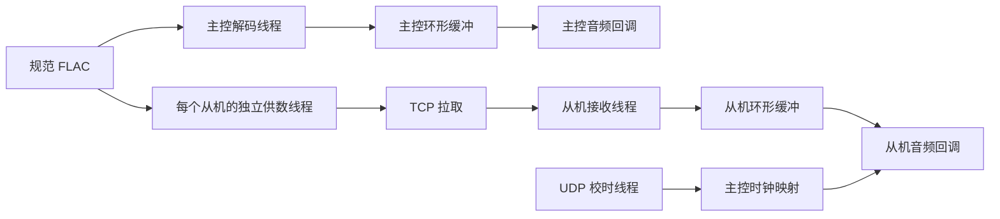

# 原生音频引擎

和鸣 1.5.0 的同步音频运行在 C++ 层，通过 Dart FFI 提供给 Flutter。API 见 [`heming_audio`](../packages/heming_audio/README.md)，网络格式见[局域网协议](protocol.md)，依赖许可见[第三方声明](../packages/heming_audio/THIRD_PARTY_NOTICES.md)。

## 音频规格与依赖

| 项目 | 当前实现 |
| --- | --- |
| 同步播放文件 | FLAC，48,000 Hz、16-bit、双声道 |
| 网络 PCM | 48,000 Hz、signed 16-bit little-endian、双声道交错 |
| 同步缓冲容量 | 每端 240,000 帧，约 5 秒、960 KB PCM |
| 单次网络读取 | 最多 4,800 帧，约 100 ms |
| 原生解码与输出适配 | 固定版本 miniaudio 0.11.26 |
| Windows 输出 | WASAPI |
| Android 输出 | AAudio |
| 原生语言与桥接 | C++17、C ABI、Dart FFI 与构建 hook |

主控和从机都使用相同的资源样本原点和音频规格。原生层提供左右声道选择、音量、静音和路径补偿；同步播放没有用户进度跳转接口。

WAV、MP3、FLAC 由原生解码器处理。额外的音频或视频输入通过 Windows Media Foundation、Android MediaExtractor / MediaCodec 尝试提取，是否支持取决于系统解码器与具体文件。应用没有随包分发 FFmpeg，也未使用 Oboe。

导入保留原件。已有规范 FLAC 可以直接播放，其他输入由用户显式生成独立的播放副本；转换完成后验证规格与完整解码，再写入可播放记录。当前 FLAC 编码器采用合法 verbatim 子帧，保留样本但压缩率接近 PCM，尚未接入预测压缩编码器。

## 线程与数据流



解码、网络等待和资源释放不在音频回调中执行。音频回调消费环形缓冲、计算输出时刻并应用声道、增益和微量重采样；Flutter 只接收状态，不搬运逐块 PCM。

从机在环形缓冲有空位时拉取下一块，避免把整首歌曲积压在发送队列。主控为每个接收者建立独立解码与供数流，本机输出另有解码线程。

TCP 两端启用 `TCP_NODELAY`，响应头与 PCM 合并提交给发送函数。回调判定供数耗尽前重新读取缓冲写位置，以免使用本轮回调开始时的旧快照；真正耗尽仍会失败停止，不在回调等待网络或重复旧样本。

## 预约输出与校时

准备阶段先打开输出设备并填充约 5 秒缓冲；短曲填充至 EOF。从机完成四时间戳校时后才能 READY。主控收齐参与设备的 READY，发送未来的共同开始时刻，各原生引擎按照单调时钟预约输出。

校时每轮选取 8 个样本中最低的有效 RTT。播放期间约每 3 秒更新，平滑调整本机与主控的时钟映射。微量线性重采样将软件漂移修正限制在 ±500 ppm。

### Windows

回调外取得 IAudioClock 服务与设备频率，回调中读取设备位置及关联 QPC 时间戳。位置先按 `GetFrequency()` 转为时间，QPC 时间戳从 100 ns 单位换算为微秒。无效、过旧、倒退或异常速率的样本被丢弃，不在回调内无限重试。

硬件速率估计至少需要 3 个约半秒的有效采样窗。输出时刻结合设备时钟、WASAPI 队列深度和硬件频差估计；频差作为漂移补偿的输入。硬件采样不可用时仍有队列预测与软件相位修正，诊断会显示该状态。

### Android

AAudio 呈现时间戳用于预测实际输出时刻，输出流的 XRun 计数用于诊断欠载。目前没有独立的 Android 硬件速率估计，相关数值不能作为已测量的设备频差。

### 路径补偿

`setLatencyCompensationMicros` 接受 `-250000..250000` 微秒，正值表示提前发送媒体以补偿额外的输出路径延迟。默认不预设未经测量的校准值，停止后保留设置。

共同时间轴、软件相位误差和播放进度都不等于扬声器的真实出声偏差。系统混音器、DAC、蓝牙和声学传播需要外部录音或测量设备验证；内置扬声器的补偿不能直接用于蓝牙设备。5 ms 是同步研究目标，不是当前已验证的产品保证。

## 停止与异常处理

缓存耗尽、原生输出中断、输出设备改变、持续校时失败或明显时钟跳变会停止输出并报告失败。`stop()` 先设置原子标志使回调静音，再异步释放输出设备与线程。TCP 接收循环可取消，避免阻塞读取拖延停止。

网络头、样本位置、规格和数据长度均有边界检查。连接关闭或握手失败后回收槽位。原生任务使用会话和任务 fingerprint 匹配数据流，控制层另外验证成员与权限；fingerprint 不属于密码学身份认证。

应用层根据主控或从机身份决定结束全组任务还是仅移出故障端，见[超时与中断](protocol.md#超时与中断)。普通后台、锁屏或音频焦点竞争保持时间轴推进，只影响本机临时增益；系统真实休眠则属于中断。

## 诊断字段

| 字段 | Windows | Android |
| --- | --- | --- |
| `hardwareRatePpm` | IAudioClock 硬件速率估计，须结合有效采样窗判断 | 尚未实现，值为 0，不能解释为零漂移 |
| `outputUnderruns` | 尚未实现计数，值为 0，不能据此认定无欠载 | 当前 AAudio 输出流的 `AAudioStream_getXRunCount` |
| `hardwareClockValid` | 最近设备位置与 QPC 时间戳是否有效 | 最近 AAudio 呈现时间戳是否有效 |
| `driftPpm` | 当前施加的软件采样率修正 | 当前施加的软件采样率修正 |
| `phaseErrorMicros` | 软件预测的输出相位误差 | 软件预测的输出相位误差 |

启动和回退期间，硬件时钟可能暂时无效。Android XRun 只属于当前输出流，重新创建流会改变计数基础；不能将新任务的零值当作全程无欠载。`phaseErrorMicros` 也不能代替多路录音测出的声学偏差。

## 本机试听

[`preview_player.cpp`](../packages/heming_audio/src/preview_player.cpp) 是独立的本机播放器，不创建同步引擎、TCP/UDP 监听器或播放组。它使用解码工作线程和约 1 秒的双声道 float32 环形缓冲，支持播放、暂停、进度跳转与音量。

试听只在未加入播放组时开放。离开资源库、应用进入后台、创建或加入播放组时停止；不申请同步播放的后台服务。取消代次阻止过期的打开、跳转或开始操作重新激活输出。试听失败不影响播放组状态。

## 验证入口

在 `packages/heming_audio` 目录运行普通包测试：

```powershell
dart test
```

真实输出测试需要可用的音频设备，通过显式环境变量启用：

```powershell
$env:HEMING_AUDIO_DEVICE_TEST = '1'
dart test test/native_loopback_test.dart
Remove-Item Env:\HEMING_AUDIO_DEVICE_TEST
```

该测试在同一台机器创建两路静音原生输出，覆盖准备屏障、TCP/UDP、预约开始、完整播放和停止清缓存。它验证原生链路，不测物理扬声器间的偏差。

CMake 的 `HEMING_BUILD_TESTS=ON` 开关启用以下确定性测试：

| 测试 | 主要覆盖 |
| --- | --- |
| `pcm_transport_framing_and_latency` | TCP 分段、头与 PCM、边界、EOF 和取消 |
| `local_preview_streaming` | 试听流式读取、跳转、取消和有界缓冲 |
| `hardware_clock_rate` | 硬件时钟速率估计与异常样本处理 |
| `output_presentation_and_drain` | 呈现时刻和末尾缓冲排空 |

完整命令与系统要求见[开发指南](build-and-test.md)，外部设备、长时播放和声学验收方法见[真机测试](physical-device-validation.md)。测试用例的存在不表示所有机型或 6 台真实设备组合已经通过验证。
